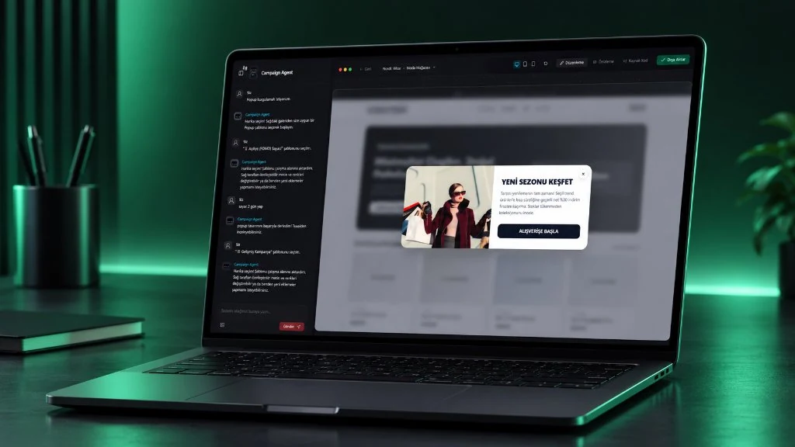
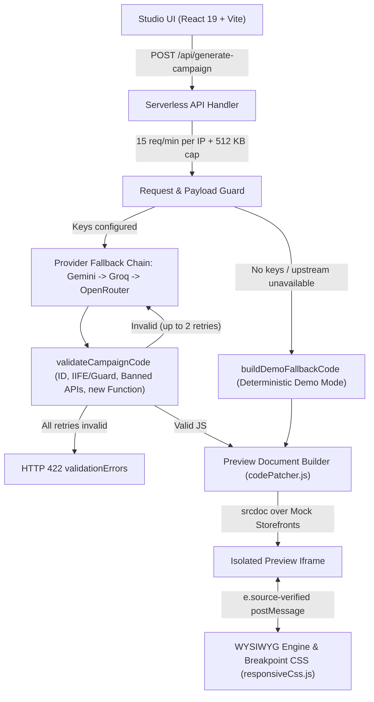
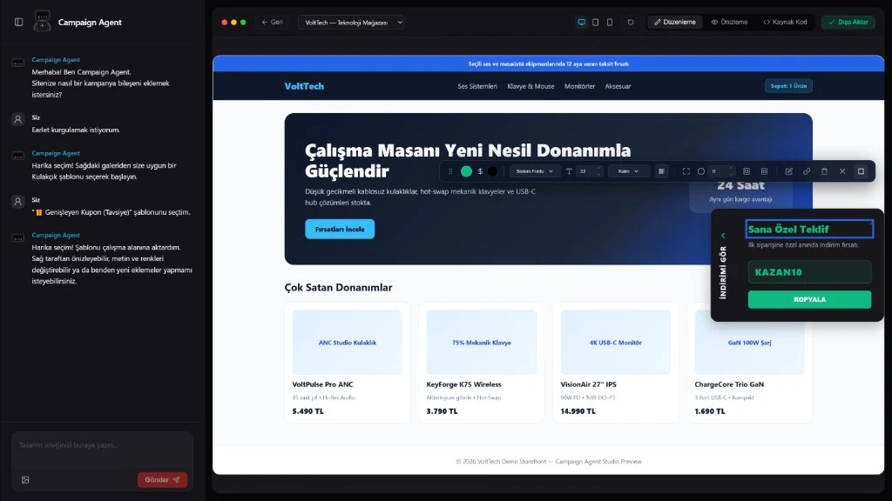
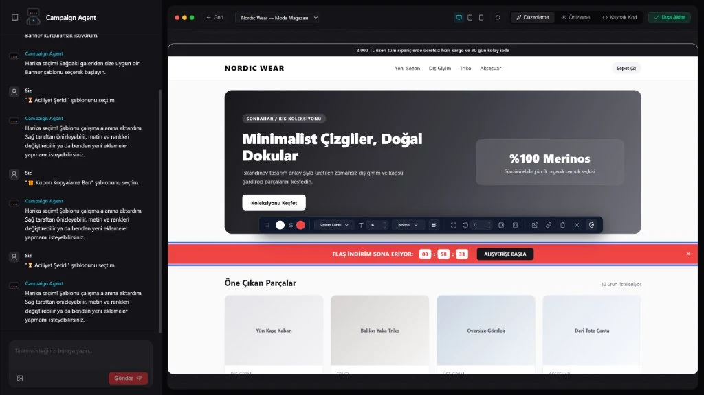

# Campaign Agent — AI No-Code Campaign Widget Studio

AI-assisted no-code widget studio for generating, visually editing, and exporting self-contained **Popup**, **Banner**, and **Earlet** JavaScript campaign widgets.

**[Live Demo](https://campaign-agent-weld.vercel.app/)** · **[Portfolio Case Study](https://kadircelikportfolyo.vercel.app/#projects)**



---

## Architecture



---

## Key Engineering Highlights & Trade-Offs

### Core Capabilities

- **Three Campaign Formats & Starter Gallery**: Create and customize **Popup** modals, **Banner** bars (fixed-top, fixed-bottom, or inline DOM-injected), and **Earlet** floating teasers (8-position anchor controls) backed by isolated `ca-widget-*` containers, `TEMPLATE_CONFIG` hooks, and `// [TRACKING_IMPRESSION]` / `// [TRACKING_CLICK]` markers.
- **Multi-Provider AI Generation + Auto-Repair**: Primary **Google Gemini REST API** (`gemini-3.1-flash-lite` -> `gemini-3.5-flash`, supporting text + up to 2 uploaded reference images) with fallback to **Groq** (`llama-3.3-70b-versatile`) and **OpenRouter** (`openrouter/free`), plus up to **2 automatic validation-repair retries** feeding exact validator errors back to the model (returning HTTP `422` if all retries fail validation).
- **Zero-Key Deterministic Demo Mode**: Runs seamlessly without API keys (or when upstream providers fail/rate-limit) via `buildDemoFallbackCode`, returning `mode: "demo"` with deterministic color, discount, and copy updates.
- **Interactive `iframe` WYSIWYG Editor**: Preview and visually edit widgets across 3 responsive mock storefronts (**Nordic Wear**, **VoltTech**, **FlowMetric**) at Desktop (`1440px`), Tablet (`768px`), and Mobile (`375px`) viewports with breakpoint-isolated `@media` CSS rules (`src/core/responsiveCss.js`), click-to-select toolbar, inline text editing, local Canvas image replacement, undo/redo history, and `window.onerror` **Auto-Fix** repair prompts.
- **Code Export & Publish Simulation**: Live editable JS tab, clipboard copy, `.js` file download, and simulated schedule modal.

### Trust Boundaries & Security Trade-Offs

1. **Same-Origin `srcdoc` Editor Trade-Off**: The visual WYSIWYG engine (`src/core/editorEngine.js`) reads `iframe.contentDocument` directly for element selection, `contenteditable` editing, computed style reading, and undo/redo DOM snapshots. Consequently, the preview `iframe` uses a same-origin `srcdoc` document over local mock storefronts (`src/core/mockStorefronts.js`) rather than an opaque cross-origin sandbox — designed for single-user authoring, not executing untrusted multi-tenant third-party scripts.
2. **`e.source`-Verified `postMessage` Bridge**: The studio listener checks `e.source === iframeRef.current?.contentWindow` and validates payload structure before handling `IFRAME_ERROR`, `UPDATE_CONFIG`, or `PATCH_JS_CODE`.
3. **Server-Side Static Validation & Banned Patterns**: `src/core/codeValidator.js` strips markdown fences/`<script>` wrappers, checks the expected `ca-widget-{popup,banner,earlet}-container` ID, enforces a duplicate-mount guard (`document.getElementById`) or IIFE wrapper, runs a `new Function(code)` syntax check, caps code at `65,000` characters, and rejects `document.cookie`, `localStorage`, `sessionStorage`, `indexedDB`, `eval(`, `new Function(`, `fetch(`, `XMLHttpRequest`, `window.top.location`, `parent.location`, `<script src=...>`, and dynamic `import(`.
4. **Rate Limiting & Payload Bounds**: `api/generate-campaign.js` enforces an in-memory per-IP rate limit (`15` requests / `60s`, max `1,000` buckets, returning `429` with `Retry-After`), a `512 KB` body cap (`413`), `1,500`-character prompt cap, and max `2` validated `data:image/...` or `https://` image inputs.
5. **Simulated Publish Modal & Local Assets**: The **Publish** modal provides real `.js` download and clipboard copy while schedule publishing is a UI simulation. Uploaded images are Canvas-compressed into data URLs locally and workspaces persist in browser `localStorage`.

---

## Screenshots

| Responsive Viewport & Breakpoint CSS | Storefront Preview & Code Inspector |
| :---: | :---: |
|  |  |

---

## Project Structure

```text
campaign-agent/
├── api/
│   └── generate-campaign.js     # Vercel & Vite middleware API with fallback chain + retry loop
├── public/                      # App icons
├── src/
│   ├── components/              # Sidebar, header, template gallery, modals, icons
│   ├── core/
│   │   ├── codePatcher.js       # TEMPLATE_CONFIG, visual edit sync & srcdoc preview builder
│   │   ├── codeValidator.js     # JS safety/syntax validator & deterministic demo generator
│   │   ├── editorEngine.js      # Iframe WYSIWYG selection, undo/redo, toolbar interactions
│   │   ├── editorToolbar.js     # Floating editor toolbar markup & styles
│   │   ├── mockStorefronts.js   # Built-in Nordic Wear, VoltTech, and FlowMetric storefronts
│   │   └── responsiveCss.js     # rgbToHex & breakpoint-isolated @media CSS generator
│   ├── services/api.js          # Client API caller & Canvas image compression
│   └── templates/               # Popup, Banner, and Earlet starter templates
├── tests/                       # Vitest unit test suites
├── .env.example
├── eslint.config.js
├── vite.config.js
├── vitest.config.js
└── LICENSE
```

---

## Local Setup & Verification

### 1. Install Dependencies & Environment (Optional)

```bash
npm install
cp .env.example .env
```

| Variable | Purpose | Default |
| --- | --- | --- |
| `GEMINI_API_KEY` | Primary Google Gemini REST API key (supports multimodal image uploads) | _(empty -> skips Gemini)_ |
| `GEMINI_MODEL` | Primary Gemini model override | `gemini-3.1-flash-lite` (fallback `gemini-3.5-flash`) |
| `GROQ_API_KEY` | Secondary OpenAI-compatible Groq API key | _(empty -> skips Groq)_ |
| `GROQ_MODEL` | Groq model override | `llama-3.3-70b-versatile` |
| `OPENROUTER_API_KEY` | Tertiary OpenAI-compatible OpenRouter API key | _(empty -> skips OpenRouter)_ |
| `OPENROUTER_MODEL` | OpenRouter model override | `openrouter/free` |
| `VITE_API_BASE_URL` | Optional API origin override for split deployments | `""` (same origin) |

> **Demo Mode Behavior:** When no API keys are configured (or upstream providers fail), `/api/generate-campaign` automatically returns a valid widget generated by `buildDemoFallbackCode` (`mode: "demo"`, `provider: "local-demo"`).

### 2. Run Development Server & Tests

```bash
npm run dev    # Serves React studio and mounts /api/generate-campaign locally
npm test       # Vitest unit tests (validator, patcher, responsive CSS, serverless API)
npm run lint   # ESLint across src/, api/, tests/, and config files
npm run build  # Production build into dist/
npm run preview
```

---

## License

[MIT](./LICENSE) © 2026 Kadir Çelik
